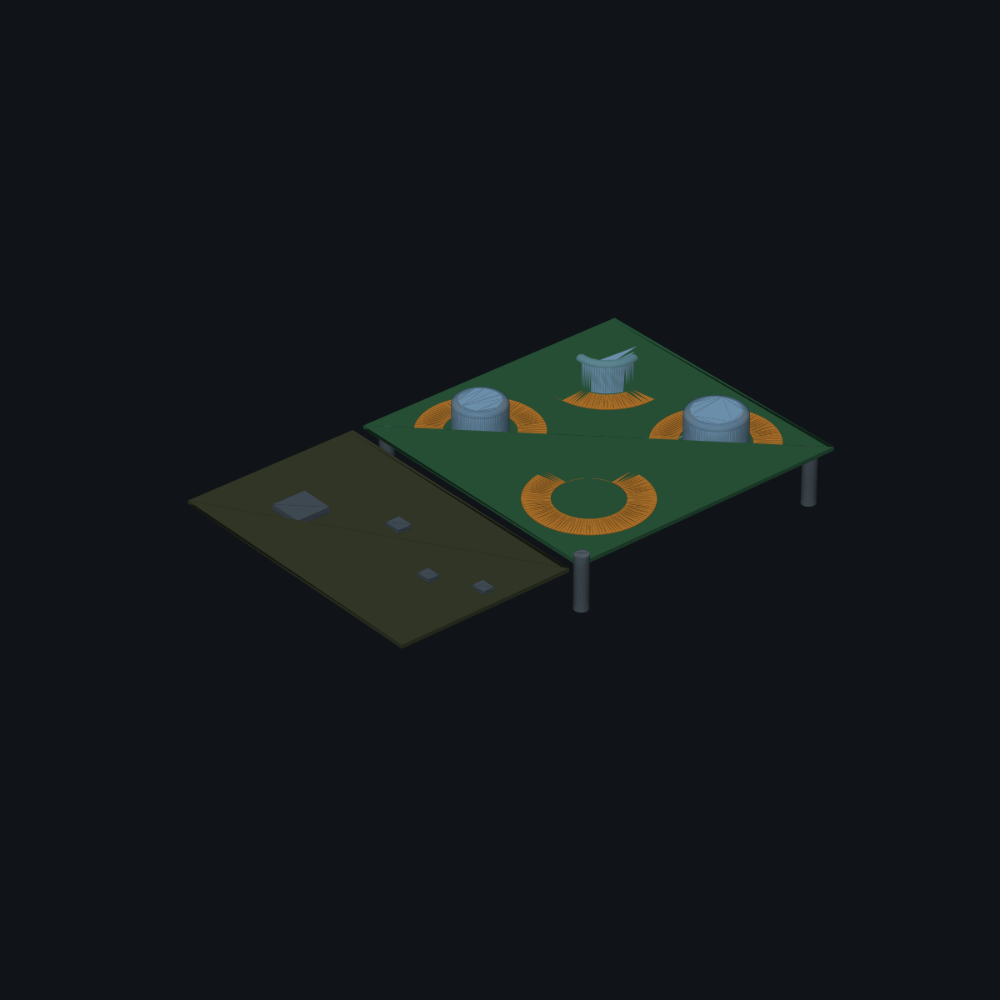
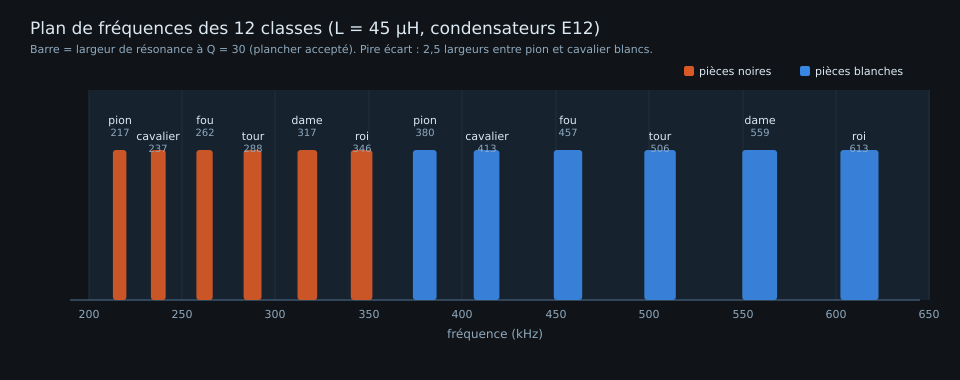
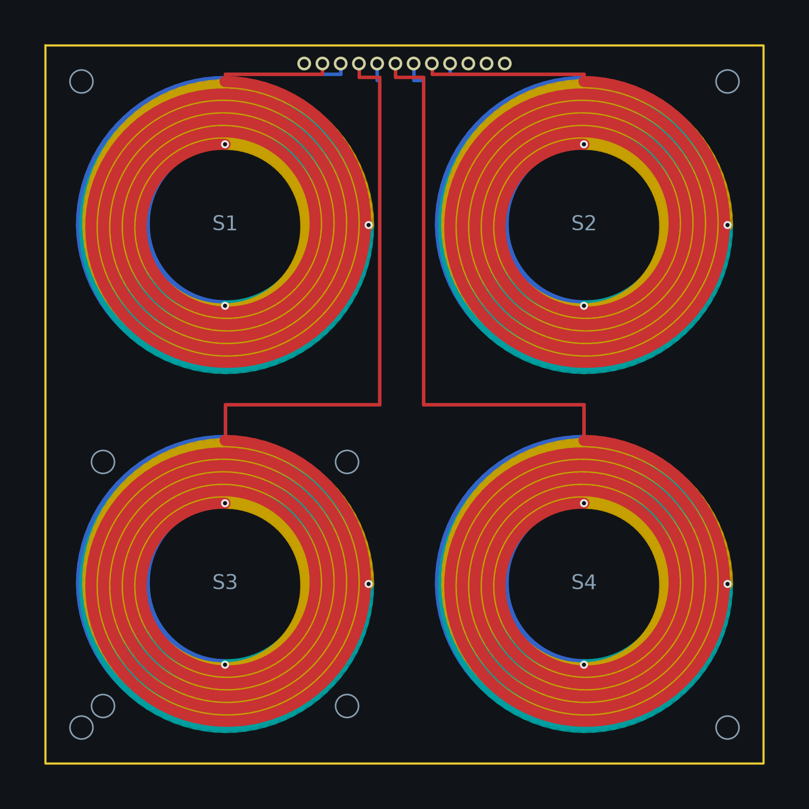
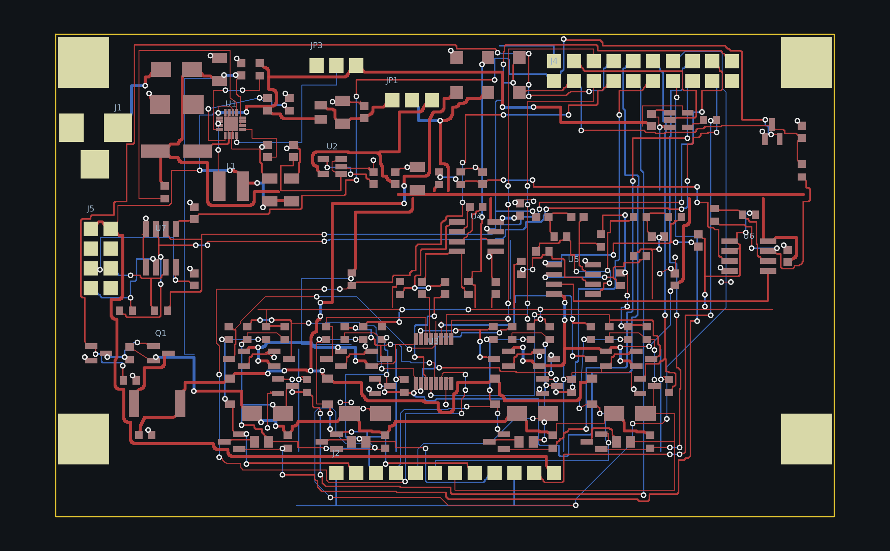
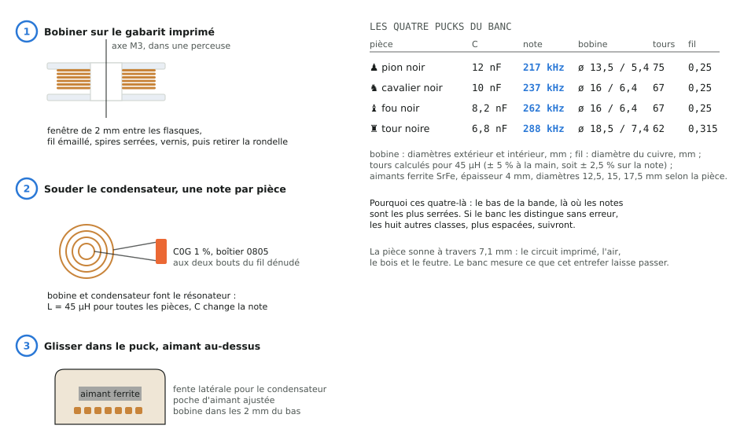

# 26. Démonstrateur A : la détection par oscillations, du colis à la première note

Rédigée le 17/10/2026, sur la branche `demonstrateur`. Elle s'adresse à
qui veut montrer, sur sa table, qu'une pièce d'échecs portant un
résonateur LC passif se reconnaît à travers 7 mm de bois et d'air par
la note qu'elle rend quand on la frappe : c'est le principe du plateau
([ADR 0001](../adr/0001-lc-resonators-for-piece-identification.md),
[note 01](01-principe-de-mesure.md)). Le démonstrateur est volontairement
le plus petit montage qui le prouve : quatre cases, quatre pièces de
test, deux cartes qui tiennent chacune dans le palier 100 x 100 mm de
JLCPCB, et une carte de développement du commerce comme cerveau.

Le démonstrateur jumeau, qui montre l'autre façon de voir les pièces
(effet Hall et RFID), est la [note 27](27-demonstrateur-hall-rfid.md).
Les deux partagent cette règle : tout nombre vient de
`config/board.yaml` par `chessboard_calc`, les nomenclatures sont celles
que les générateurs écrivent, et rien ne se commande tant que les
contrôles de la section 4 ne sont pas verts.

À retenir :

- Quatre objets : la **carte bobines** (100 x 100, quatre spirales de
  détection dans le cuivre, rien à souder), la **carte analogique**
  (100 x 62, le frontal qui frappe les bobines et écoute), une
  **NUCLEO-G474RE** (le microcontrôleur du futur cerveau, sa sonde et
  son port série), et quatre **pucks** (bobine, condensateur, aimant).
  Plus un morceau de contreplaqué, du feutre, une alimentation 12 V.
- Les deux cartes existent déjà, fermées et vérifiées : routage sans
  liaison ouverte, DRC KiCad à zéro erreur, archives de fabrication
  commitées avec leur empreinte. On les commande telles quelles.
- Coût : la [nomenclature chiffrée](../bom-demonstrateur-a.md) donne
  les composants ligne à ligne ; la [fiche de coûts](../couts-demonstrateurs.md)
  ajoute les cartes nues, la Nucleo, les matériaux des pucks et du bois,
  l'outillage et le port, par catégorie, avec un minimum (environ
  320 USD outillage compris, dont 175 d'instruments qu'on n'achète
  qu'une fois) et un complet options comprises.
- On monte par échelons, un test par échelon. La mesure qui compte est
  la **note d'un puck posé sur sa case**, puis le **Q avec l'aimant
  ferrite** (M2) : c'est elle qui dit si la technologie tient.

## 1. Ce qu'on construit



Le principe en trois temps, pour chaque case :

1. **Frapper.** Un transistor relie la bobine de la case au 12 V
   pendant une microseconde ; le courant monte, puis la bobine est
   lâchée. Ce front raide contient toutes les fréquences de 200 à
   650 kHz : il excite n'importe quel résonateur posé au-dessus.
2. **Écouter.** Deux microsecondes de silence (le temps que la bobine
   de la carte, amortie, se taise), puis 128 µs d'écoute : le
   résonateur de la pièce, excité, sonne à sa note et rayonne vers la
   bobine de la case, qui capte quelques dizaines de millivolts.
3. **Reconnaître.** La chaîne analogique amplifie 200 fois, filtre la
   bande 200 à 650 kHz, et le microcontrôleur numérise 512 points à
   3,78 Méch/s ; une FFT donne la fréquence, et une seconde voie
   (comparateur et capture de période) la confirme. Chaque pièce a
   sa note : le condensateur de son résonateur fixe la classe.

Le plan de fréquences, calculé par `python -m chessboard_calc report` :

| Pièce | C (nF) | Note (kHz) |
|---|---|---|
| pion noir | 12 | 216,6 |
| cavalier noir | 10 | 237,3 |
| fou noir | 8,2 | 262,0 |
| tour noire | 6,8 | 287,7 |
| dame noire | 5,6 | 317,0 |
| roi noir | 4,7 | 346,1 |
| pion blanc | 3,9 | 379,9 |
| cavalier blanc | 3,3 | 413,0 |
| fou blanc | 2,7 | 456,6 |
| tour blanche | 2,2 | 505,8 |
| dame blanche | 1,8 | 559,2 |
| roi blanc | 1,5 | 612,6 |

Les quatre pièces de test sont le bas de la bande, les notes les plus
serrées : pion, cavalier, fou et tour noirs (`mockup.test_pieces`). Si
le montage les distingue, il distingue les douze.



## 2. Les composants : nature et rôle

### 2.1 La carte bobines



Une carte passive de 100 x 100 mm, quatre couches, sans aucun
composant ([README](../../hardware/mockup-2x2/coil-board/README.md)).

| Élément | Nature | Rôle |
|---|---|---|
| S1 à S4, les spirales | 4 couches de 5 tours en série, piste 1,6 mm, 40 mm de diamètre extérieur ; environ 16 µH (`sense_coil`) | la bobine de chaque case : elle frappe la pièce et l'écoute. Quatre couches en série pour l'inductance et le couplage, une piste large pour la résistance (le Q de la bobine) |
| J1 | barrette mâle 1 x 12 au pas 2,54 mm, la seule pièce à souder | relie les deux bornes de chaque spirale (A et B) à la carte analogique, masse aux deux bouts ; les broches 11 et 12 (DIN, 5V) restent sans cuivre sur cette version passive |
| H1 à H4 | trous M3 aux coins | les entretoises qui portent la surface de jeu |
| les quatre trous autour de S3 | M3 au pas de 34 mm | le support d'aimant réglable de la mesure M7, inutile au démonstrateur |

Pourquoi quatre couches : la spirale est modélisée comme une bobine de
hauteur égale à l'épaisseur de la carte (1,6 mm), et l'empilement
standard de JLCPCB met 0,5 oz de cuivre sur les couches internes là où
le modèle en suppose 1 oz. L'option « cuivre interne 1 oz » coûte 10 à
25 EUR de plus et donne la carte du modèle ; sans elle la résistance
de la spirale monte de 50 % et son Q perd un tiers
([note 23](23-commande-jlcpcb.md), paragraphe 3.1). Pour un démonstrateur,
les deux fonctionnent ; pour mesurer ce que le plateau mesurera,
prendre l'option.

### 2.2 La carte analogique



Une carte de 100 x 62 mm, deux couches, 128 composants, générée par
`tools/analoggen` ([README](../../hardware/mockup-2x2/analog-board/README.md)).
Sur le démonstrateur on n'en monte qu'une partie, l'« option A » de la
[fiche du pilote](../bom-pilote.md) : le convertisseur à découpage,
la liaison isolée vers un Raspberry Pi et le tampon de LED restent
vides. Bloc par bloc, dans l'ordre du signal :

**L'alimentation.** Le 12 V entre par le jack J1 (5,5 x 2,1 mm, positif
au centre). D1 (SS34, Schottky) interdit une alimentation branchée à
l'envers ; D2 (SMBJ15A) écrête les surtensions ; C1 (47 µF) et C2
(10 µF) sont la réserve d'énergie des impulsions, qui tirent jusqu'à
2 A pendant une microseconde. Le 5 V analogique (5VA) vient du
régulateur linéaire U2 (LP2985-5.0) : un régulateur linéaire fait moins
de bruit qu'un convertisseur à découpage, et la chaîne mesure des
microvolts. Le cavalier JP1 choisit la source du 5VA : **broches 2 et 3,
le LDO**, la seule position sur le démonstrateur (le buck U1 n'est pas
monté). R5, R6 et C13 fabriquent la **référence VREF de 1,65 V**, à
mi-chemin des 3,3 V du microcontrôleur : toute la chaîne est centrée
dessus, pour que le signal amplifié reste dans la plage de l'ADC.

**Les quatre cellules de bobine** (une par case, repères 2x pour la
case 1, 3x pour la 2, 4x pour la 3, 5x pour la 4) :

| Repères (cellule 1) | Composant | Rôle |
|---|---|---|
| R21, R22 | 10 kΩ | polarisent les deux bornes de la bobine à VREF au repos |
| R23, R24, D11, D12 | 330 Ω et deux BAV99 | écrêteurs : entre la bobine, qui voit 12 V à l'impulsion, et le multiplexeur, qui ne supporte que 5 V, la résistance limite le courant et les diodes doubles renvoient tout excès vers 5VA ou la masse |
| D31 | B5819W, Schottky | diode de bus : isole la bobine du rail d'impulsion commun quand sa cellule ne frappe pas |
| Q11, R25 | AO3400A, N-FET, et son rappel 100 kΩ | l'interrupteur d'excitation : fermé une microseconde par `DRIVE1`, il tire la borne B de la bobine à la masse, le courant monte depuis le rail d'impulsion |
| D41 | SS34 | roue libre : quand Q11 s'ouvre, le courant de la bobine se referme vers le 12 V au lieu de faire une surtension destructrice |
| Q21, R26, R27 | AO3401A, P-FET, 680 Ω, rappel 100 kΩ | l'amortisseur : au repos et pendant le silence après l'impulsion, le P-FET met 680 Ω en parallèle sur la bobine de la carte pour tuer sa propre sonnerie (elle sonnerait sinon à sa fréquence propre et masquerait la pièce) ; `DAMP1_N` bas l'active |

**Le rail d'impulsion commun** : Q1 (AO3401A) relie le 12 V au bus
`DRIVE_BUS` à travers R9 (10 Ω, boîtier 2512 pour la puissance
crête) quand Q2 (AO3400A), commandé par `PULSE_EN`, tire sa grille ;
R7, R8 et R10 sont les rappels. Un seul rail pour les quatre cellules,
une diode de bus par cellule.

**Le multiplexeur** U3 (74HCT4052, deux voies 4 vers 1) choisit la case
écoutée : il amène les deux bornes de la bobine sélectionnée, en
différentiel, vers l'amplificateur. HCT et non HC : ses seuils TTL
acceptent les 3,3 V du microcontrôleur alors qu'il est alimenté en 5 V.
`MUX_A0`, `MUX_A1` adressent, `MUX_INH` coupe.

**L'amplificateur d'instrumentation** U4 (AD8421), gain 20 fixé par
R14 (523 Ω) : il mesure la différence entre les deux bornes de la
bobine et rejette ce que les deux voient en commun (le bruit du 12 V,
le rayonnement de la pièce voisine). C'est le composant le plus cher
de la carte, avec les deux OPA2810 ; c'est aussi celui qui fixe le
plancher de bruit (4 nV/√Hz).

**Les filtres** U5 et U6 (deux OPA2810, doubles amplificateurs à
105 MHz) : deux cellules de Sallen-Key, un passe-haut à 200 kHz
(R15, R16, C17, C18) et un passe-bas à 650 kHz (R19, R20, C19, C20),
chacune de gain 1,586 (R17, R18 ; R61, R62). Elles laissent la bande des
douze notes et coupent le reste : les 50 Hz et leurs harmoniques, le
bruit haute fréquence. La seconde moitié de U6 est le tampon de VREF ;
la seconde moitié de U5 est l'étage de sortie, gain 4,57 (R63 3,57 kΩ,
R64 1 kΩ), qui ramène le gain total vers 200 à 400 kHz. R65 (49,9 Ω) et
C24 (1 nF) forment le RC qui adapte la sortie à l'échantillonneur de
l'ADC. La chaîne est validée par simulation ngspice
(`hardware/mockup-2x2/analog-board/chain-spice.cir`, [note 13](13-revue-et-verification.md)).

**La liaison au microcontrôleur** J4 (2 x 10 au pas 2,54 mm) porte le
3,3 V, les masses, la sortie `AMP_OUT`, les commandes du multiplexeur,
`PULSE_EN`, les quatre `DRIVE` et les quatre `DAMP_N`, l'UART. J2
(1 x 12 femelle coudée) reçoit la barrette de la carte bobines. Six
points de test : TP1 `INA_OUT` (après l'AD8421), TP2 `AMP_OUT` (sortie
de chaîne), TP3 `VREF`, TP4 `5VA`, TP5 `GND`, TP6 `DRIVE_BUS`.

**Non monté sur le démonstrateur** : U1, L1, R1 à R4, C4 à C8, FB1, JP3
(le buck TPS62150 et son filtre, la comparaison buck contre LDO de la
mesure M8 n'a pas lieu ici), U7, C26, J5, R66, R67 (la liaison isolée
vers un Pi), U8, R68, C27 (le tampon de la chaîne de LED, la carte
bobines passive n'a pas de LED). La liste exacte est dans la
[nomenclature](../bom-demonstrateur-a.md), section « Non monté ».

### 2.3 La Nucleo

La NUCLEO-G474RE porte le STM32G474RE que le plateau emploiera comme
cerveau ([ADR 0003](../adr/0003-stm32-master-pi-optional.md)), sa sonde
ST-Link (programmation et port série virtuel par le même câble USB), et
les connecteurs Arduino sur lesquels on câble J4. Rien à souder. Le
firmware du démonstrateur est `firmware/mockup`, écrit pour cette
carte : il frappe, écoute, calcule la FFT et la période, et parle en
CSV sur le port série.

### 2.4 Les pucks



Un puck est une pièce d'échecs réduite à ce qui compte : un **résonateur
LC** (une bobine plate de 45 µH et un condensateur C0G à 1 %) et un
**aimant ferrite** (le plateau final déplacera les pièces par un aimant
sous la table ; la ferrite, contrairement au néodyme, laisse passer le
champ de mesure, [ADR 0002](../adr/0002-hard-ferrite-piece-magnets.md),
[note 18](18-facteur-q.md)). Pour les quatre pièces de test, à p = 50 mm :

| Pièce | Base (mm) | Bobine, diamètre ext. et int. (mm) | Tours, fil (mm) | C0G | Aimant ferrite (mm) |
|---|---|---|---|---|---|
| pion noir | 17,5 | 13,5 et 5,4 | 75 tours de 0,25 | 12 nF | 12 x 4 (modèle 12,5) |
| cavalier noir | 20,0 | 16,0 et 6,4 | 67 tours de 0,25 | 10 nF | 15 x 4 |
| fou noir | 20,0 | 16,0 et 6,4 | 67 tours de 0,25 | 8,2 nF | 15 x 4 |
| tour noire | 22,5 | 18,5 et 7,4 | 62 tours de 0,315 | 6,8 nF | 18 x 4 (modèle 17,5) |

Les gabarits de bobinage et les corps de puck s'impriment depuis
`mechanical/` (`python mechanical/build_all.py`, STL dans
`mechanical/exports/`). Le condensateur se choisit en C0G (NP0) à 1 %,
boîtier 0805 ou 1206 : une autre diélectrique (X7R) dériverait en
température et en tension, et la note avec elle.

### 2.5 La surface et le reste

Du contreplaqué sec de 3 mm (`gap.surface_mm`), un feutre de 0,5 mm, des
entretoises nylon de 2 mm entre la carte bobines et le bois
(`gap.air_mm`) : l'entrefer total du modèle est 1,6 + 2,0 + 3,0 + 0,5 =
7,1 mm. Le gabarit `surface-template` de `mechanical/` perce le bois au
droit des trous de fixation. Une alimentation 12 V (laboratoire,
limitée en courant au début, ou un bloc 12 V 2 A à jack 5,5 x 2,1 ; pas
un chargeur à découpage posé près des bobines), vingt nappes Dupont
femelle-femelle, un câble USB pour la Nucleo.

## 3. Comment les blocs travaillent ensemble


La séquence d'une mesure, celle que le firmware déroule pour chaque
case (`firmware/mockup/README.md`) :

1. Les quatre `DAMP_N` sont bas : les quatre bobines de la carte sont
   amorties. Le multiplexeur est adressé sur la case visée.
2. L'amortisseur de la case visée s'ouvre ; `PULSE_EN` monte, Q1 arme le
   rail d'impulsion ; `DRIVEk` ferme Q1k pendant 1 µs : le courant monte
   dans la spirale.
3. Q1k s'ouvre : le courant se referme dans D4k, le champ s'effondre, le
   résonateur de la pièce est lancé.
4. 2 µs de silence (blanking) : l'amortisseur retue la sonnerie propre
   de la spirale ; puis il s'ouvre pour l'écoute.
5. Pendant 128 µs, l'AD8421 amplifie ce que la spirale capte, les
   filtres nettoient, l'ADC prend 512 points à 3,78 Méch/s ; en
   parallèle le comparateur COMP1 (seuil DAC) et le timer TIM2
   capturent les périodes du signal (voie B).
6. L'amortisseur se referme ; FFT avec interpolation parabolique (voie
   A) et médiane des périodes (voie B) ; une ligne CSV
   `sq,fa_hz,fb_hz,amp_mv,snr_db10`.

Ce que chaque bloc apporte à cette séquence, et ce qui arrive sans
lui : sans amortisseur, la spirale sonne à sa propre fréquence et noie
la pièce ; sans écrêteurs, le multiplexeur meurt à la première
impulsion ; sans la référence à 1,65 V, le signal amplifié sort de la
plage de l'ADC ; sans filtre passe-haut, les 50 Hz saturent la chaîne ;
sans la double voie, une erreur de FFT passe inaperçue. La
[note 01](01-principe-de-mesure.md) donne la physique et la
[note 07](07-etat-et-reste-a-faire.md) la place de ce démonstrateur
dans le projet.

## 4. Commander

### 4.1 Vérifier avant de commander

```bash
cd hardware/mockup-2x2/coil-board && sha256sum -c coil-board-gerbers.sha256 && cd -
cd hardware/mockup-2x2/analog-board && sha256sum -c analog-board-gerbers.sha256 && cd -
python3 tools/fabcheck.py hardware/mockup-2x2/coil-board hardware/mockup-2x2/analog-board
/usr/bin/python3 tools/drc.py hardware/mockup-2x2/coil-board/coil-board.kicad_pcb \
    hardware/mockup-2x2/analog-board/analog-board.kicad_pcb
```

Les deux empreintes doivent répondre `OK`, `fabcheck` doit dire
`assembly ready` pour la carte bobines et `bare boards ready` pour la
carte analogique, et le DRC `0 failing` et `unconnected items: 0` sur
les deux. État au 17/10/2026 : vérifié, les quatre lignes passent.

### 4.2 Les deux circuits imprimés chez JLCPCB

Téléverser `coil-board-gerbers.zip` puis `analog-board-gerbers.zip`
(deux commandes dans le même panier), options d'après la
[note 23](23-commande-jlcpcb.md) :

| Champ | Carte bobines | Carte analogique |
|---|---|---|
| Couches | 4 | 2 |
| Dimensions | 100 x 100 mm | 100 x 62 mm |
| Quantité | 5 (minimum) | 5 |
| Épaisseur | 1,6 mm (entre dans l'entrefer du modèle) | 1,6 mm |
| Cuivre externe | 1 oz | 1 oz |
| Cuivre interne | **1 oz, option payante conseillée** (3.1 de la note 23) | sans objet |
| Finition | HASL sans plomb (aucun boîtier fin) | HASL sans plomb |
| Via | tented | tented |
| Numéro de commande | retiré, ou emplacement imposé : la carte est un capteur | indifférent |
| Assemblage | aucun : la carte est passive | aucun : on soude au fer (section 5) ; sinon assemblage économique face avant avec `jlc-bom.csv` et `jlc-cpl.csv`, 40 lignes sur 128 ont un code LCSC |
| Pochoir | non | optionnel, utile si l'on soude à la pâte |

### 4.3 Les composants

La [nomenclature chiffrée](../bom-demonstrateur-a.md) donne, ligne par
ligne, les repères, la quantité avec la rechange, le code LCSC et le
numéro Mouser avec leur lien et leur prix, et le canal le moins cher ;
les paniers `docs/panier-demonstrateur-a-lcsc.csv` et
`docs/panier-demonstrateur-a-mouser.csv` s'importent tels quels dans les
deux sites. En résumé :

- **Chez Mouser** (ou DigiKey, Farnell) : la NUCLEO-G474RE, les deux
  OPA2810IDR (absents de LCSC), et tout ce qu'on veut acheter d'un seul
  tenant ; au-dessus de 50 EUR HT le port est offert.
- **Chez LCSC** (envoi groupé avec la commande JLCPCB) : l'AD8421ARZ,
  le 74HCT4052PW, le LP2985-5.0, les FET AO3400A et AO3401A, les diodes
  SS34, B5819W, BAV99, SMBJ15A, le jack, et les passifs 0603, 0805, 2512
  par valeur.
- **Ailleurs** : les aimants ferrite Y30 (12, 15 et 18 mm sur 4 mm,
  boutique d'aimants), le fil émaillé 0,25 et 0,315 mm (E44 ou
  équivalent), les quatre C0G 1 % des résonateurs (12, 10, 8,2 et 6,8 nF
  en 0805 ou 1206), le contreplaqué, le feutre, la visserie nylon M3.

### 4.4 L'outillage

Un fer fin et du flux, une tresse, des brucelles, une loupe ; un
multimètre ; une alimentation limitée en courant ; un oscilloscope,
même de poche (la bande des notes monte à 650 kHz : 10 MHz suffisent) ;
un LCR-mètre est le luxe qui tranche en une minute une bobine douteuse.

## 5. Assembler

### 5.1 La carte bobines

Souder la barrette J1 (douze broches, droite si la carte analogique se
pose à côté, coudée si l'on veut les deux cartes coplanaires), visser
les quatre entretoises M3. C'est tout.

### 5.2 La carte analogique

L'ordre, du plus fin au plus gros, carte à plat :

1. Les circuits intégrés en SOIC et TSSOP : U4 (AD8421), U5 et U6
   (OPA2810), U3 (74HCT4052), repère de broche 1 face au point de la
   sérigraphie ; une broche d'ancrage, puis les autres, tresse en cas
   de pont. U2 (LP2985, SOT-23-5).
2. Les transistors (dix SOT-23, deux références : AO3400A et AO3401A,
   ne pas les mélanger) et les diodes (BAV99 en SOT-23 ; SS34 et SMBJ15A
   en boîtiers SMA et SMB, bague de cathode face au trait ; B5819W en
   SOD-123).
3. Les résistances et condensateurs, par valeur, en cochant la
   nomenclature : R9 est le 2512, R26 à R56 les 0805 de 680 Ω.
4. Les traversants : J1 le jack, J2 l'embase femelle coudée, J4 la
   barrette 2 x 10, JP1 la barrette 1 x 3 et son cavalier en 2-3.
5. Laisser vides U1, L1, R1 à R4, C4 à C8, FB1, JP3, U7, C26, J5, R66,
   R67, U8, R68, C27.
6. Nettoyer le flux à l'alcool isopropylique : la chaîne traite des
   microvolts.

Pour situer les repères, la face composants tracée par KiCad et le
schéma sont dans `hardware/mockup-2x2/analog-board/` (ouvrir
`analog-board.kicad_pro` ; sans KiCad, le rendu `docs/images/analog-board.png`).

### 5.3 Câbler la Nucleo

Nappes Dupont de J4 vers les connecteurs Arduino de la Nucleo, table
tirée de `config/board.yaml` (section `mockup.nucleo_pins`) :

| J4 | Signal | Nucleo | Broche STM32 |
|---|---|---|---|
| 1 | 3V3 | 3V3 | |
| 2, 4, 19 | GND | GND | |
| 3 | AMP_OUT | A0, et un pont vers A1 pour la voie B | PA0, PA1 |
| 5 | MUX_A0 | D3 | PB3 |
| 6 | MUX_A1 | D4 | PB5 |
| 7 | MUX_INH | D5 | PB4 |
| 8 | PULSE_EN | A2 | PA4 |
| 9 à 12 | DRIVE1 à DRIVE4 | D11, D12, D14, D15 | PA7, PA6, PB9, PB8 |
| 13 à 16 | DAMP1_N à DAMP4_N | D6, D7, D9, D10 | PB10, PA8, PC7, PB6 |
| 17, 18 | MCU_TX, MCU_RX | non câblés sur le démonstrateur | |
| 20 | INA_OUT | libre : la sonde de l'oscilloscope | |

Le 5 V de la carte analogique ne va jamais à la Nucleo (elle vit de son
USB) ; seuls le 3,3 V et la masse sont partagés.

### 5.4 Les pucks

La recette de la [note 20](20-tuto-banc.md), paragraphe 4.3 : imprimer
le gabarit du bon diamètre, bobiner à la perceuse le nombre de tours de
la table 2.4, vernir, dénuder, souder le condensateur, mesurer L (45 µH
à ± 5 %) si un LCR-mètre est là, glisser la bobine, le condensateur et
l'aimant dans le puck, marquer sa classe. Quatre bobines à la main
donnent quatre notes à ± 2,5 % : c'est attendu, la calibration du
firmware mesure chaque pièce.

### 5.5 Le bois

Percer au gabarit, coller le feutre, poser sur les entretoises de 2 mm.
Rien de métallique entre la carte et les pucks : une vis en acier au
milieu d'une case change sa note.

## 6. Tester

La règle : un échelon à la fois, noter ce qu'on lit, ne passer au
suivant qu'après. Les tensions se lisent sur les points de test de la
carte analogique : TP4 `5VA`, TP3 `VREF`, TP5 `GND`, TP6 `DRIVE_BUS`,
TP1 `INA_OUT`, TP2 `AMP_OUT`.

1. **Carte analogique seule, ohmmètre.** Entre 12 V (broche centrale du
   jack), 5VA (TP4) et la masse : jamais zéro ohm.
2. **12 V seul, sans Nucleo.** Alimentation limitée à 100 mA : TP4 à
   5,0 V, TP3 à 1,65 V, consommation de quelques milliampères. Si le
   courant part en butée, couper et chercher un pont de soudure ou une
   diode à l'envers.
3. **Nucleo et console.**

   ```bash
   cd firmware/mockup
   make              # build/mockup.bin
   make flash        # rappelle la copie du .bin sur le lecteur NUCLEO
   ```

   Ouvrir le port série de la sonde à **921600 bauds** (par exemple
   `screen /dev/ttyACM0 921600`) : la bannière affiche la cadence
   d'échantillonnage réelle (3,78 Méch/s) et l'en-tête du CSV. La touche
   `h` liste les commandes.
4. **Les deux cartes, sans puck.** Barrette J1 dans J2, nappes
   branchées, 12 V rebranché : `s` écrit quatre lignes CSV avec une
   note quelconque et une amplitude faible, c'est le bruit. À
   l'oscilloscope, sonde sur TP6 pour le déclenchement et sur TP2 :
   l'impulsion de 1 µs, 2 µs de silence, puis une trace centrée sur
   1,65 V qui doit rester calme (la spirale est amortie). Une sonnerie
   qui dure ici est une spirale qui n'est pas amortie : Q2k ou R2k.
5. **Un puck, sa note.** Le pion noir sur une case, sans son aimant :
   `s` donne sur cette case `fa_hz` proche de 216 600 (± 3 %),
   `fb_hz` à quelques centaines de hertz de `fa_hz`, une amplitude
   nettement au-dessus des cases vides. `r` vide les 512 points bruts
   de la case 1 : tracés, une sinusoïde qui décroît doucement sur
   toute la fenêtre. Si elle est plate en haut, la chaîne écrête :
   le modèle prévoit 24 V en sortie pour 0,12 V sur la spirale
   ([fiche du pilote](../bom-pilote.md), paragraphe 6), donc le gain est
   probablement trop fort pour l'entrefer réel : retirer R14 (gain 1 à
   l'AD8421) ou la remplacer par 1 à 2 kΩ, et noter l'amplitude lue au
   journal : c'est la première mesure que ce démonstrateur établit.
6. **Le Q, puis l'aimant (M1 et M2).** Même puck, `r` sauvé en CSV ;
   `measurements/analysis.py` extrait le Q par décrément logarithmique
   (attendu ≥ 40 sans aimant). Insérer l'aimant ferrite, recommencer :
   le Q doit rester ≥ 30 et ne pas chuter de plus de 20 %. C'est la
   mesure pivot du projet ([protocole](../../measurements/protocol.md),
   M1 et M2) ; pour comparer, un aimant néodyme à la place fait chuter
   le Q de 40 à 70 % (M3).
7. **Quatre pucks, calibration, identification.** Un puck par case ;
   `c` mesure seize fois chaque case et range les quatre notes en flash ;
   `i` reconnaît ; permuter deux pucks et refaire `i` : les noms doivent
   suivre. Puis l'entrefer : poser le bois et le feutre, refaire `s` et
   `i` ; les notes ne bougent pas, l'amplitude baisse (M4, SNR attendu
   ≥ 20 dB) ; cales de 1 mm jusqu'à 8 mm d'entrefer total (M4bis).
8. **La diaphonie et la dispersion.** Un seul puck sur la case 1,
   amplitude lue sur les trois autres (M5, critère ≤ -20 dB) ; deux
   pucks identiques côte à côte, décalage de note (M5bis, < 3 kHz) ;
   quatre bobines au même gabarit dans le même puck (M6, ± 3 %).

À la fin de l'échelon 7, le démonstrateur a montré ce qu'il devait :
quatre pièces reconnues à travers l'entrefer du plateau, et la mesure
qui décide (M2) est faite.

## 7. Si ça ne marche pas

| Symptôme | Où regarder |
|---|---|
| Pas de console | le port série est celui de la sonde ST-Link (ttyACM sous Linux), 921600 bauds, le `.bin` est celui de `firmware/mockup/build/` |
| TP4 sans 5 V | polarité du jack, D1 à l'envers, cavalier JP1 absent ou en 1-2 sans buck monté |
| TP3 à 0 ou à 5 V | R5, R6, C13, ou la moitié B de U6 (le tampon) |
| Console vivante, `s` sans amplitude même avec un puck | J1 et J2 mal engagés (broche 1 sur broche 1, x = 38,57 mm sur les deux cartes) ; MUX_INH resté haut (D5) ; TP6 à l'oscilloscope pendant `s` : l'impulsion doit y être |
| Note très différente de celle attendue | condensateur ou nombre de tours ; un LCR-mètre tranche ; du métal près de la case |
| Q faible, sonnerie courte | métal, bobine mal vernie, aimant néodyme à la place de la ferrite ; comparer M1 et M2 |
| Sonnerie écrêtée | gain trop fort pour l'entrefer réel : R14 vers 1 à 2 kΩ, ou retirée |
| Une case sur quatre muette | sa cellule : Q1k, D3k, D4k, l'écrêteur ; permuter les pucks pour séparer la case de la pièce |
| Toutes les notes décalées ensemble | la cadence de l'ADC : la bannière affiche 3,78 Méch/s, le firmware en tient compte ; un quartz ou une horloge différente les décale |

## 8. Lexique

- **Résonateur LC** : une bobine (L) et un condensateur (C) qui
  échangent leur énergie à une fréquence propre ; frappé, il sonne à
  cette note et s'éteint d'autant plus lentement que son Q est grand.
- **Q, facteur de qualité** : le nombre d'oscillations avant que
  l'amplitude ne tombe d'un facteur 23 (e^π) ; 30 veut dire une
  sonnerie exploitable pendant toute la fenêtre d'écoute.
- **Ringdown, sonnerie** : l'oscillation amortie qui suit l'impulsion.
- **Blanking** : le silence imposé entre l'impulsion et l'écoute, le
  temps que la bobine de la carte se taise.
- **Amplificateur d'instrumentation** : un amplificateur à deux entrées
  qui n'amplifie que leur différence ; ce que les deux fils captent
  ensemble disparaît.
- **Sallen-Key** : une cellule de filtre à un amplificateur, deux
  résistances et deux condensateurs ; deux cellules font le passe-bande.
- **Mux, multiplexeur** : un commutateur électronique qui choisit une
  voie parmi plusieurs.
- **CMS, SOIC, TSSOP, SOT-23** : boîtiers montés en surface, du plus
  large au plus fin ; tous se soudent au fer avec du flux.
- **C0G, NP0** : la diélectrique céramique stable en température et en
  tension, la seule admise pour un résonateur.
