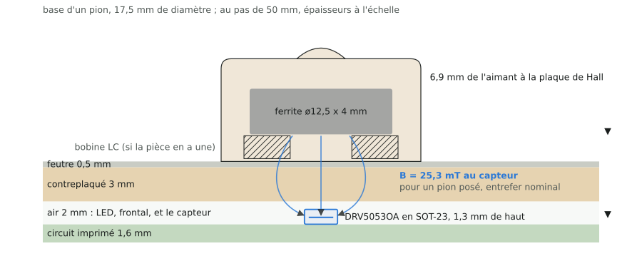
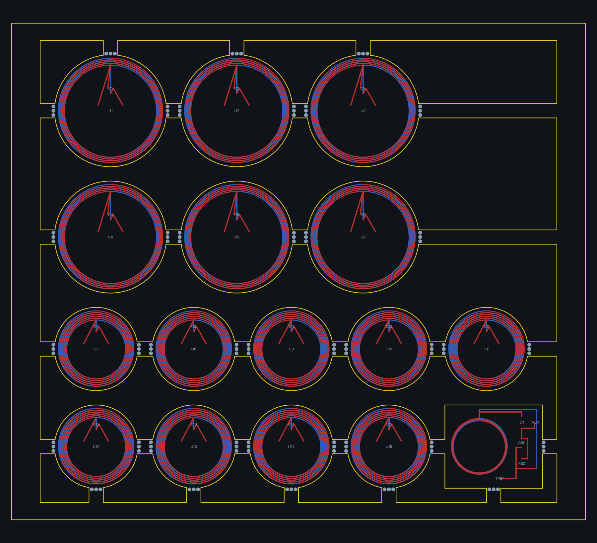

# 27. Démonstrateur B : effet Hall et RFID, du colis à la première lecture

Rédigée le 17/10/2026, sur la branche `demonstrateur`. Elle s'adresse à
qui veut montrer, sur sa table, l'autre façon de voir les pièces,
celle de la [note 24](24-hall-et-rfid.md) : un **capteur à effet Hall**
sous chaque case sent l'aimant que la pièce porte dans sa base (la case
est occupée, et par quelle couleur) ; une **boucle NFC** dessinée dans le
cuivre de la case, pilotée par un lecteur MFRC522, lit l'**étiquette
RFID** collée sous la pièce (quelle pièce). Le démonstrateur est le banc
de la [note 25](25-maquette-hall-rfid.md) réduit à ce qui tient dans le
palier 100 x 100 mm de JLCPCB : **une rangée de deux cases**, une boucle
de chaque géométrie, deux lecteurs, six capteurs, un ESP32-S3, et une
**planche de quinze étiquettes** à la taille des pièces. Rien de ce qu'il
mesure ne tranche pour le plateau ; il produit les mesures qui
permettront de trancher (ADR 0001, note 24 section 7).

Le démonstrateur jumeau, la détection par oscillations LC, est la
[note 26](26-demonstrateur-lc.md). Même règle pour les deux : tout nombre
vient de `config/board.yaml` par `chessboard_calc`, les nomenclatures
sont celles que les générateurs écrivent, rien ne se commande tant que
les contrôles de la section 4 ne sont pas verts.

À retenir :

- Deux cartes générées par le dépôt : **`hallrfid-demo`** (100 x 100,
  4 couches, 166 composants, dont deux lecteurs et six capteurs) et la
  planche **`tag-demo`** (100 x 86,5, 2 couches, 0,8 mm, 15 étiquettes et
  une vignette de champ). Les deux se régénèrent d'une commande.
- La carte principale se commande **assemblée** (JLCPCB, face avant),
  ou nue pour qui soude le QFN et le module au fer. La planche se
  commande nue : les puces d'étiquette se soudent au fer.
- Coût : voir la [nomenclature chiffrée](../bom-demonstrateur-b.md),
  regénérée par `tools/demobom.py --model b` ; les prix sont des relevés
  web, à confirmer au panier.
- Le micrologiciel `firmware/esp32/hallrfid-demo` (ESP-IDF) donne une
  console de mise en route : lecture des capteurs, réveil d'un lecteur,
  `VersionReg`, émission à conductance réglée, lecture d'UID.
- La mesure qui compte est double : la **lecture d'une étiquette P à
  travers l'entrefer du plateau** avec un champ sous la limite (M13a),
  et la **cohabitation** avec l'aimant Hall dans la même base (M14a).

## 1. Ce qu'on construit

Une case, vue de dessus et en coupe :



Deux mesures indépendantes par case :

1. **Hall.** La pièce porte un aimant ferrite (le même qu'au modèle A,
   ADR 0002). Un capteur linéaire DRV5055A3 sous le centre de la case
   rend 1,65 V à champ nul et 15 mV par millitesla ; le pion le plus
   faible donne 410 pas de l'ADC, le roi appuyé 2,17 V. Un pôle sud
   face au boîtier fait monter la sortie, un pôle nord la fait
   descendre : l'orientation de l'aimant code la couleur. Six capteurs
   sur la carte : un au centre de chaque case, et quatre autour du
   centre de A1, aux points (±0,1 p, ±0,1 p), pour mesurer ce que gagne
   un amas face au décentrage des pièces (M12).
2. **RFID.** Une boucle carrée dans le cuivre de la case, 3 spires de
   30 mm de côté sur A1 (L60x3) ou 2 spires de 35 mm sur B1 (L70x2),
   est accordée à 13,56 MHz par un réseau d'adaptation et pilotée par
   un MFRC522. Sous la pièce, une étiquette NT3H2111 (NXP NTAG I2C
   plus) sur un disque de 14,5 ou 19,5 mm répond son UID : c'est
   l'identité de la pièce. Deux géométries de boucle sur la même carte
   pour les comparer (D5).

Les deux cases sont au pas p = 50 mm, celui du modèle de la maquette ;
la carte se régénère au pas de 40 en changeant une ligne du yaml
(`hall_rfid.mockup.pitch_mm`), géométrie, réseaux d'adaptation et
nomenclature suivent.


La carte : la **zone de jeu** (y de 0 à 50 mm) porte les deux boucles,
les six capteurs et leurs filtres, sans aucun cuivre de masse (le plan
de masse dans une boucle en tuerait le Q, D12) et sans aucune autre
piste que les trios des capteurs, qui sortent par leur couloir ; la
**bande** (y de 50 à 100) porte le reste. Quatre couches : les signaux
sur les deux faces, le plan de masse sur la première couche interne,
borné à la bande et arrêté à 4 mm des boucles, la seconde couche
interne libre pour les alimentations et les liaisons longues (deux
couches seules laissaient un tiers des liaisons ouvertes). Chaque
lecteur est dans la bande, juste sous sa boucle, son réseau
d'adaptation entre les deux. Six trous M3 (coins de la zone de jeu et
coins de la bande), trois mires d'assemblage.

## 2. Les composants : nature et rôle

### 2.1 La zone de jeu

| Repères | Composant | Rôle |
|---|---|---|
| L1, L2 | les boucles NFC, du cuivre de la face avant, un pont sur la face arrière, et un « net tie » (une empreinte sans composant qui relie les deux bouts du dessin) | l'antenne de chaque case : L1 fait 3 spires de 30 mm (L60x3, ouverture 22 mm), L2 fait 2 spires de 35 mm (L70x2, ouverture 30 mm), piste et écart au pas des boucles du modèle (`nfc.antenna`) |
| U11 à U16 | DRV5055A3, SOT-23 (1 VCC, 2 OUT, 3 GND) | les capteurs Hall : U11 au centre de A1, U12 au centre de B1, U13 à U16 l'amas de A1 ; ratiométriques, leur sortie suit leur alimentation |
| C11 à C16 | 100 nF | le découplage de chaque capteur, au plus près |
| R11 à R16, C21 à C26 | 1 kΩ et 10 nF | le filtre RC de chaque sortie : -59 dB à 13,56 MHz, pour que la porteuse captée par les pistes n'entre pas dans l'ADC ; la résistance près du capteur, le condensateur à l'arrivée, hors de la boucle |

Les trois pistes de chaque capteur (alimentation, sortie, masse) sortent
de la boucle en trio serré sur la face arrière, à angle droit, par le
couloir réservé à l'ouest de l'alimentation de la boucle : écartées,
elles capteraient 150 à 190 mV de porteuse ; serrées, 24 à 30 mV, que le
filtre ramène à quelques dizaines de microvolts (`nfc.hall_trace_pickup`).

### 2.2 Les deux lecteurs

Le lecteur de A1 porte les repères 1xx, celui de B1 les repères 2xx. Pour
le lecteur n :

| Repères | Composant | Rôle |
|---|---|---|
| Un | MFRC522 (NXP MFRC52202HN1,151), HVQFN-32 5 x 5 mm | le lecteur : émetteur 13,56 MHz sur TX1 et TX2, récepteur sur RX, SPI vers l'ESP32 ; `I2C` à la masse et `EA` au 3,3 V le mettent en SPI, `MFIN` inutilisé va à PVSS comme la fiche l'impose |
| Yn, Cn01, Cn02 | quartz 27,12 MHz 3225, 2 x 15 pF C0G | l'horloge du lecteur ; la porteuse en est la moitié |
| Cn03 à Cn05, Cn09 | 100 nF x 3, 1 µF | découplage des alimentations numérique, analogique et de l'oscillateur |
| Rn01, Cn07, Cn08, TPn04 | 1 Ω, 10 µF, 100 nF, point de test | l'alimentation de l'émetteur TVDD : la résistance de 1 Ω est l'ampèremètre intégré, 50 mV lus au multimètre pour 50 mA, sans rien dessouder |
| Rn11, Rn21 | 0 Ω | isolateurs : dessoudés, ils séparent l'émetteur du réseau pour mesurer celui-ci au NanoVNA depuis son entrée |
| Jn01, Jn02 | U.FL, non montés | les prises du NanoVNA, une par demi-réseau |
| Ln11, Ln21 ; Cn11, Cn21 | 560 nH ; 220 pF | le filtre CEM de chaque côté : un passe-bas à 14,34 MHz qui laisse la porteuse et coupe ses harmoniques |
| Cn12, Cn13 ; Cn22, Cn23 | C1 : 56 + 5,6 pF sur A1, 82 + 3,3 pF sur B1 | la capacité série du réseau d'adaptation, valeur E12 principale et complément en parallèle |
| Cn15, Cn16 ; Cn25, Cn26 | C2 : 470 + 33 pF sur A1, 680 + 56 pF sur B1 | la capacité parallèle du réseau, idem |
| Cn14, Cn17, Cn24, Cn27 | non montés | les emplacements de retouche après l'accord au NanoVNA |
| Rn12, Rn22 | Rq : 0,68 Ω sur A1, 0,47 Ω sur B1 | l'amortissement qui fixe le Q chargé de la boucle à 24, pour que la bande passante laisse passer la modulation de l'étiquette |
| Rn31, Rn32, JPn01 | R1 : 3,9 kΩ sur A1, 3,3 kΩ sur B1 ; la seconde non montée, pontée par un cavalier à souder | le diviseur de réception depuis le nœud C0 de la branche ouest : le nœud porte 7 à 8 V crête à crête à pleine puissance, RX n'en accepte que 4 ; le cavalier ouvert et la seconde R1 montée divisent par deux pour les essais à pleine puissance (D15) |
| Cn31, Rn33, Cn06 | 1 nF, 1 kΩ, 100 nF | couplage vers RX, résistance vers VMID, découplage de VMID : le schéma type de la fiche NXP |
| Rn41, Rn42 | 10 kΩ | NSS tirée au 3,3 V (lecteur non sélectionné par défaut), NRSTPD tirée à la masse (aucune émission avant que le micrologiciel ne le décide) |
| Rn43 | 0 Ω, non monté | contourne le tampon MISO (U7) si la mesure montre qu'il est inutile |
| TPn01 à TPn05 | points de test | TX1, TX2, RX, TVDD, masse |

Les valeurs des réseaux viennent de `nfc.matching` pour chaque
géométrie, au pas et avec l'étiquette d'accord du yaml
(`hall_rfid.mockup.matching.tune_tag`, l'étiquette P nue à l'entrefer
nominal) ; la table complète, impédances, courants et niveaux à RX, est
au paragraphe 4.4 de la note 25. Deux chiffres à garder en tête : à
pleine conductance, le courant TVDD attendu est de 49 mA (A1) et 44 mA
(B1), 65 et 59 au pire des tolérances, pour une limite de 100 mA ; une
boucle dont l'inductance s'écarte de 10 % du modèle le pousserait vers
160 mA. D'où la règle : **première émission à conductance réduite,
courant TVDD lu sur la résistance de 1 Ω, pleine conductance seulement
après l'accord et un courant mesuré sous 70 mA**.

### 2.3 La bande

| Repères | Composant | Rôle |
|---|---|---|
| J1, R61, R62, U5 | USB-C (GCT USB4085), 2 x 5,1 kΩ, USBLC6-2SC6 | l'alimentation et la console : 5 V du port, les deux 5,1 kΩ sur CC demandent 5 V à un hôte USB-C, le USBLC6 protège les lignes de données ; l'USB natif de l'ESP32-S3 (GPIO19, GPIO20) sert de port série et de sonde JTAG |
| J2, TP3 | barrette 1 x 2 « 5V BENCH », point de test VBUS | la première mise sous tension par une alimentation de laboratoire limitée en courant, jamais en même temps que l'USB |
| U6, C61, C62, C63 | AMS1117-3.3 (ou LD1117S33 de ST, même brochage SOT-223), 10 µF, 22 µF tantale, 100 nF | le 3,3 V de toute la carte ; le tantale est la charge que l'AMS1117 exige pour être stable |
| U4, C51, C52 | ESP32-S3-WROOM-1-N8, 10 µF, 100 nF | le cerveau : SPI vers les lecteurs, ADC pour les capteurs, USB ; son antenne dépasse du bord de la carte, sans cuivre dessous |
| R51, C53, SW2 ; R52, SW1 | 10 kΩ, 1 µF, bouton EN ; 10 kΩ, bouton BOOT | la remise à zéro et le mode de téléchargement ; BOOT tenu à la mise sous tension force le chargeur si le module ne s'énumère pas |
| D1, R53 | LED 0603, 1 kΩ | la LED de l'utilisateur (GPIO8) |
| TP5, TP6 | points de test | UART0 (GPIO43, GPIO44) : la console de secours par un adaptateur USB série 3,3 V |
| U3, C31, R31 | CD74HC4067, 100 nF, 0 Ω | le multiplexeur 16 voies : les six capteurs sur les voies 0, 1 et 4 à 7, et des références sur les voies libres (ci-dessous) ; sa validation à la masse par le 0 Ω |
| R32, R33 | 2 x 10 kΩ | voie 9 : le rail commuté des capteurs divisé par deux, la référence ratiométrique que le micrologiciel lit avec chaque mesure |
| R34, R35, C32 | 2 x 10 kΩ, 10 nF | voie 10 : l'échelon de la LED à travers un diviseur par deux et un RC connu, pour chronométrer l'échantillonnage |
| J3 | barrette 1 x 6 | voies 11 à 15 et masse : des sondes extérieures, une future nappe |
| Q1, R41, JP1, C41, C42 | AO3401A (P-FET), 10 kΩ, cavalier à souder ouvert, 1 µF, 100 nF | le rail commuté des six capteurs (`ROW_EN1`) : la carte mesure leur mise sous tension et leur courant ; le cavalier fermé les alimente en permanence |
| U7, C71 | 74LVC125, 100 nF | le tampon MISO : le MISO d'un MFRC522 n'est pas garanti en haute impédance quand sa NSS est haute ; une porte par lecteur, validée par sa NSS, isole les deux ; les 0 Ω non montés R143 et R243 permettent de s'en passer et de mesurer s'il était nécessaire |
| R71 | 10 kΩ | la ligne IRQ commune des lecteurs, en drain ouvert, tirée au 3,3 V |
| J5, C54 | barrette 1 x 3 « PICKUP », 10 nF | l'entrée de la vignette de champ (planche d'étiquettes) : trois fils torsadés, signal, masse, 3,3 V ; le 10 nF filtre à l'arrivée |
| J4 | barrette 2 x 10, non montée | la barrette d'échappement : si le module ne démarre pas, une ESP32-S3-DevKitC branchée ici pilote toute la carte (brochage dans le yaml, `hall_rfid.demo.escape_header`) |
| TP1, TP2, TP4, TP7 | points de test | 3,3 V, masse, rail des capteurs, masse |
| FID1 à FID3 | mires 1 mm | les repères d'alignement de la machine de pose |

Brochage de l'ESP32-S3 (`hall_rfid.demo.esp32.pins`) : les quatre
entrées analogiques sont sur l'ADC1 (GPIO1 `MUX_OUT`, GPIO2 `HALL_A1`,
GPIO4 `HALL_B1`, GPIO5 `PICKUP`), aucune broche de démarrage ni de
PSRAM n'est employée (le test `test_pin_map_rules` le garantit) :

| Signal | GPIO | Signal | GPIO |
|---|---|---|---|
| MUX_OUT | 1 | SPI_MISO | 13 |
| HALL_A1 | 2 | NSS_A1 | 14 |
| HALL_B1 | 4 | MUX_S0 à MUX_S3 | 15, 16, 17, 18 |
| PICKUP | 5 | USB_DM, USB_DP | 19, 20 |
| LED | 8 | NRSTPD_A1 | 21 |
| RFID_IRQ | 9 | NSS_B1 | 38 |
| ROW_EN1 | 10 | UART0_TX, UART0_RX | 43, 44 |
| SPI_MOSI, SPI_SCK | 11, 12 | NRSTPD_B1 | 47 |

Bilan de courant (`hallrfid_demo.power`) : ESP32 100 mA, un émetteur à
100 mA au plus, deux lecteurs éveillés 38 mA, six capteurs 60 mA, soit
298 mA sur le 3,3 V, sous les 500 mA d'un port USB et le 1 A du
régulateur.

### 2.4 La planche d'étiquettes



Le [README de la planche](../../hardware/tag-demo/README.md) décrit
chaque disque. En résumé : quinze disques, trois par variante, retenus
par des attaches à trous de souris ; sur chacun une bobine à deux
couches (la spirale de la face avant part du centre vers le bord, un via
au bord, celle de la face arrière revient), une puce **NT3H2111W0FTTJ**
(TSSOP-8, broches LA et LB sur les deux bouts de la bobine, les autres en
l'air : la puce vit du champ du lecteur), et un condensateur 0402 C0G
d'accord sur les variantes qui en portent :

| Variante | Disque | Accord | Pour |
|---|---|---|---|
| P | 14,5 mm | 17,3 MHz, sans condensateur | pion, cavalier, fou |
| P + 15 pF | 14,5 mm | 15,2 MHz | le compromis de la note 25 |
| P + 22 pF | 14,5 mm | 14,5 MHz | la meilleure marge d'activation |
| G | 19,5 mm | 16,1 MHz | tour, dame, roi |
| G + 10 pF | 19,5 mm | 14,7 MHz | la seule G qui tient au pas de 40 |

Une étiquette accordée au-dessus de 13,56 MHz est voulue : posée sur
la boucle, le couplage la tire vers le bas, et une étiquette accordée
trop bas décroche. Les trois variantes P mesurent où se trouve le bon
accord (M13a).

La **vignette de champ**, en bas à droite de la planche : une bobine de
10 mm, une diode Schottky à faible seuil BAT15-03W, 1 nF et 100 kΩ, deux
pastilles de sortie. Soudée à la main et reliée à `PICKUP` par trois
fils torsadés, étalonnée au NanoVNA, elle donne une mesure relative du
champ sans oscilloscope : c'est elle qui dit si le champ de service
reste sous la limite de 7,5 A/m à l'étiquette.

### 2.5 Le reste

Les aimants ferrite des pièces (12, 15 et 18 x 4 mm), les pièces de test
imprimées de la note 25 (`mechanical/`, un logement d'étiquette et un
aimant amovible dans la base), une plaque de surface et des cales
d'entrefer, des entretoises nylon de 30 mm (toute mesure RF se fait
carte en l'air, loin du métal), un NanoVNA avec deux câbles U.FL vers
SMA (60 à 90 EUR, le seul instrument que le démonstrateur demande au
delà du multimètre), une carte NTAG213 du commerce comme référence, un
téléphone NFC pour lire chaque étiquette avant de la monter.

## 3. Comment les blocs travaillent ensemble

Un cycle du micrologiciel, pour la rangée :

1. **Présence.** `ROW_EN1` bas : Q1 alimente les six capteurs ; 260 µs
   plus tard (mise sous tension du capteur et charge des filtres), le
   multiplexeur est adressé voie par voie, 34 µs d'établissement
   chacune (le 10 nF partagé encaisse la charge du nœud commun du mux),
   l'ADC lit ; les voies 8 (masse) et 9 (rail divisé par deux) donnent le
   zéro et la pente du chemin, les entrées directes `HALL_A1` et
   `HALL_B1` servent de comparaison. Un écart à la ligne de base au delà
   du seuil fait la case occupée, son signe fait la couleur.
2. **Identité.** Pour une case devenue occupée : NSS du lecteur bas, le
   lecteur passe en émission à sa conductance de service, une
   séquence ISO 14443A (REQA, anticollision, SELECT) lit l'UID de
   l'étiquette ; émission ramenée à l'état tenu, NSS haute. Un seul
   émetteur à la fois.
3. **L'autre lecteur pendant ce temps** reste dans l'état « tenu » :
   émetteurs validés, `Force100ASK` à 1, `DriverSel` à 10, enveloppe
   nulle, l'état où la fiche tient TX1 et TX2 à 0. Une boucle voisine
   laissée flottante servirait de relais et porterait 21 à 39 % du flux
   vers la case d'à côté (`nfc.neighbor_relay`) ; tenue, 6 à 13 %. Le
   micrologiciel n'écrit jamais `DriverSel` à 00.

Ce qui arrive sans un bloc : sans le filtre RC, la porteuse de 13,56 MHz
entre dans l'ADC par les pistes des capteurs ; sans le rail commuté, la
carte ne mesure ni la mise sous tension ni le courant des capteurs ;
sans l'ampèremètre de 1 Ω, la première émission se fait à l'aveugle ;
sans le tampon MISO, un lecteur non sélectionné peut tenir la ligne et
rendre l'autre muet ; sans la masse coupée autour des boucles, leur Q
tombe et l'accord ne tient plus (D12).

## 4. Commander

### 4.1 Régénérer et vérifier

```bash
PYTHONPATH=tools .venv/bin/python -m boardgen build hallrfid-demo --render docs/images/hallrfid-demo.png
PYTHONPATH=tools .venv/bin/python -m taggen build --render docs/images/tag-demo.png
/usr/bin/python3 tools/drc.py hardware/hallrfid-demo/hallrfid-demo.kicad_pcb hardware/tag-demo/tag-demo.kicad_pcb
/usr/bin/python3 tools/gerbers.py hardware/hallrfid-demo/hallrfid-demo.kicad_pcb
/usr/bin/python3 tools/gerbers.py hardware/tag-demo/tag-demo.kicad_pcb
python3 tools/fabcheck.py hardware/hallrfid-demo hardware/tag-demo
cd hardware/hallrfid-demo && sha256sum -c hallrfid-demo-gerbers.sha256 && cd -
cd hardware/tag-demo && sha256sum -c tag-demo-gerbers.sha256 && cd -
```

Le build doit finir sur `open 0, clearance errors 0`, le DRC sur
`0 failing` et `unconnected items: 0` pour les deux cartes, `fabcheck`
sur `assembly ready` pour la carte principale, et les deux empreintes
doivent répondre `OK`. L'état au jour de la rédaction est au
[README de la carte](../../hardware/hallrfid-demo/README.md).

### 4.2 Les deux circuits imprimés chez JLCPCB

Téléverser `hallrfid-demo-gerbers.zip` puis `tag-demo-gerbers.zip`,
options d'après la [note 23](23-commande-jlcpcb.md) et le paragraphe 8
de la note 25 :

| Champ | Carte principale | Planche d'étiquettes |
|---|---|---|
| Couches | **4** | 2 |
| Dimensions | 100 x 100 mm | 100 x 86,5 mm |
| Quantité | 5 | 5 |
| Épaisseur | 1,6 mm | **0,8 mm** (le disque entre dans la base d'une pièce) |
| Cuivre | 1 oz externe, 0,5 oz interne (le standard suffit : les couches internes ne portent que la masse et des signaux) | 1 oz |
| Finition | **ENIG** si assemblée (QFN 0,5 mm et module), HASL sans plomb sinon | HASL sans plomb, ENIG si l'on veut un disque plus plat |
| Via | tented | tented |
| Panneau | non | « Panel by Customer », 4 conceptions déclarées (P, G, vignette, cadre) |
| Numéro de commande | emplacement imposé dans la bande, jamais dans la zone de jeu | retiré |
| Assemblage | **Standard, face avant**, 2 cartes, `jlc-bom.csv` et `jlc-cpl.csv` : le module ESP32 et le MFRC522 sont des pièces étendues, le Standard les pose sans supplément de classe ; vérifier à l'aperçu que chaque ligne a trouvé son code et que les non montés (U.FL, retouches, R43, R32, J4) sont bien exclus | aucun : les puces TSSOP-8 se soudent au fer ; sinon, l'option en XQFN8 (C710403) est documentée dans le README de la planche |
| Pochoir | non si assemblée ; oui pour souder soi-même à la pâte | non |

Les codes LCSC des passifs sont des « basiques » JLCPCB, vérifiés à
l'aperçu de la commande le jour même, comme pour chaque carte du dépôt
(note 23, paragraphe 5).

### 4.3 Les composants

La [nomenclature chiffrée](../bom-demonstrateur-b.md) donne, ligne par
ligne, les repères, la quantité avec la rechange, le code LCSC et le
numéro Mouser avec leur lien et leur prix, et le canal le moins cher ;
les paniers `docs/panier-demonstrateur-b-lcsc.csv` et
`docs/panier-demonstrateur-b-mouser.csv` s'importent dans les deux
sites. Si la carte est assemblée par JLCPCB, il ne reste à acheter que :

- **Chez LCSC ou Mouser** : les puces d'étiquette NT3H2111W0FTTJ (15,
  plus deux de rechange), les 0402 C0G d'accord (10, 15, 22 pF), la
  BAT15-03W et le 1 nF, 100 kΩ de la vignette, les deux barrettes, un
  cavalier ; et, en rechange, un MFRC522 et un DRV5055A3.
- **Ailleurs** : les aimants ferrite, le NanoVNA et ses câbles U.FL,
  une carte NTAG213, la visserie nylon M3 et les entretoises de 30 mm,
  le ruban polyimide qui tient les disques dans les bases.

Si la carte est commandée nue, toutes les lignes de `bom.csv` sont à
acheter ; le MFRC522 en QFN demande un fer à air chaud ou une plaque,
le module ESP32 se soude au fer.

### 4.4 L'outillage

Multimètre (le courant TVDD se lit en millivolts), alimentation de
laboratoire limitée en courant, fer fin et flux, loupe ; NanoVNA et un
téléphone NFC ; un oscilloscope est utile, non nécessaire (la vignette
le remplace pour le champ).

## 5. Assembler

### 5.1 La carte principale, si elle arrive assemblée

Contrôle visuel à la loupe des deux QFN (pas de bille entre les
broches, pastille centrale soudée : un léger reflet sous le boîtier),
du module et du SSOP du multiplexeur. Puis les traversants, les seuls
que JLCPCB ne pose pas : J2, J3, J5 (barrettes), et, si on le veut, J4
(2 x 10, à monter seulement si le module fait défaut). Les cavaliers à
souder sont dans leur état de livraison : JP1 ouvert (rail commuté
actif), JP101 et JP201 fermés (une seule R1).

### 5.2 La carte principale, si on la soude soi-même

Dans l'ordre : les deux MFRC522 (pâte, air chaud ou plaque, la pastille
centrale est la masse), U3 (SSOP 0,65 mm), U7 (TSSOP), U5, U6, Q1, les
six SOT-23 des capteurs (le repère de broche 1 vers l'ouest, la
sérigraphie le montre), puis tous les 0603 par valeur en cochant
`bom.csv` (les réseaux d'adaptation ont des valeurs voisines, 56 et
5,6 pF, 470 et 33 pF : étiqueter les bandes), les 1206, le tantale (la
barre marque le plus), les quartz, les selfs, l'USB-C (les pattes
traversantes se soudent par le dessous), les boutons, la LED, le
module (pads sur le pourtour, fer large, la pastille centrale peut
rester vide), les traversants. Nettoyer le flux.

### 5.3 La planche d'étiquettes

Souder les quinze puces (TSSOP-8, broche 1 vers le repère), les neuf
condensateurs d'accord (3 x 15 pF et 3 x 22 pF sur les P, 3 x 10 pF sur
trois des G), et les trois composants de la vignette. Lire chaque
étiquette au téléphone **avant de la détacher** : une puce qui ne
répond pas au téléphone est mal soudée, et la planche entière tient
mieux dans la main qu'un disque de 14,5 mm. Noter l'UID et la variante
de chaque disque. Détacher au cutter le long des trous de souris,
ébavurer. Le disque entre dans l'alésage de la base d'une pièce de test,
puce vers le haut, tenu par un ruban polyimide ; l'aimant ferrite
au-dessus, pôle sud vers le bas pour une couleur, nord pour l'autre.

### 5.4 La vignette

Trois fils torsadés de 30 cm des deux pastilles et de la masse vers J5
(signal, masse, 3,3 V). Elle se pose à plat sur la boucle, à l'entrefer
nominal, pour l'étalonnage et les mesures de champ.

### 5.5 Le banc

Carte sur ses quatre entretoises de 30 mm, posée sur une table sans
métal ; plaque de surface et cales sur les entretoises des coins de la
zone de jeu. Le câble USB-C vers l'ordinateur ; ou, pour la première
mise sous tension, l'alimentation de laboratoire sur J2.

## 6. Tester

Le micrologiciel `firmware/esp32/hallrfid-demo` donne les commandes ;
la [mise en route](../../measurements/protocol.md) du protocole (note
25, paragraphe 10.1) donne les critères, repris ici avec les valeurs du
yaml. Noter au [journal](09-journal.md) chaque courant et la valeur de
`VersionReg` de chaque lecteur.

```bash
. ~/esp/esp-idf/export.sh
cd firmware/esp32/hallrfid-demo
idf.py set-target esp32s3 && idf.py build
idf.py -p /dev/ttyACM0 flash monitor      # la console est sur l'USB natif
```

1. **Ohmmètre, carte hors tension.** Entre VBUS (TP3), 3,3 V (TP1) et
   la masse (TP2) : jamais zéro ohm.
2. **Première tension par J2**, alimentation à 5 V limitée à **150 mA**,
   USB débranché. Lecteurs en mise hors tension matérielle (c'est
   l'état des rappels), rail des capteurs coupé. Critère : 3,3 V sur
   TP1, courant de l'ESP32 seul (quelques dizaines de milliampères),
   aucun échauffement.
3. **Flashage par l'USB-C.** Alimentation débranchée, câble USB : le
   module s'énumère en port série ; sinon BOOT tenu à la mise sous
   tension. La console répond à `h`. Si le module ne démarre pas : J4 et
   une DevKitC.
4. **Les capteurs.** Limite portée à **400 mA** si l'on reste sur J2.
   `e` alimente le rail (`ROW_EN1`) : le courant monte de 36 mA (6 x
   6 mA, 60 au plus) ; `s` lit les huit voies (six capteurs, masse, rail
   divisé par deux) et les deux entrées directes, en comptes ADC ; `z`
   prend les lectures courantes comme zéros. Un aimant passé à la main
   sur chaque capteur, pôle sud face au boîtier, fait monter sa voie,
   et pour U11 et U12 l'entrée directe en même temps (M12d compare les
   deux chemins).
5. **Les lecteurs, émission coupée.** `w 1` réveille le lecteur de A1
   (NRSTPD haute) et lit `VersionReg` : **0x91 ou 0x92** pour la puce
   NXP, courant en hausse de 13,5 mA (19 au plus) ; `w 2` de même.
6. **Première émission, un seul lecteur, conductance minimale.** Carte
   sur ses entretoises, loin de tout métal. `t 1 8` met l'émetteur de
   A1 en marche avec `CWGsP` à 8 (sur 63) : lire le courant TVDD en
   millivolts sur TP104 contre TP105 (1 Ω : 1 mV par milliampère), le
   noter, monter par pas (`t 1 16`, `t 1 24`) tant qu'il reste **sous
   70 mA**. À chaque pas, `r 1` tente une lecture : une carte NTAG213
   du commerce posée sur la boucle, puis une étiquette P0 déjà lue au
   téléphone. L'UID affiché doit être celui que le téléphone a lu.
   `o 1` ramène l'émetteur à l'état tenu.
7. **L'accord au NanoVNA.** Dessouder R111 et R121, monter J101 et
   J102, mesurer S11 et S21 à travers le réseau avec l'étiquette P nue
   posée à l'entrefer nominal (méthode au protocole, « Accord au
   NanoVNA ») ; retoucher par C114, C117, C124, C127. Ressouder les 0 Ω.
   Seulement alors `t 1 63` et le courant TVDD mesuré : attendu 49 mA
   sur A1 et 44 mA sur B1, 65 et 59 au pire. Même chose pour B1.
8. **La vignette.** `p` lit l'entrée PICKUP ; vignette à plat sur la
   boucle à l'entrefer nominal, conductance par pas : la conductance de
   service est la plus forte qui garde le champ sous **7,5 A/m** à la
   vignette (étalonnage et table au protocole). Noter cette conductance
   par case : c'est celle du service.
9. **M13a, la lecture à travers l'entrefer.** Plaque de surface, une
   étiquette P0 dans une pièce de test au centre de A1, conductance de
   service : `R 1 100` fait cent lectures et compte les réussites ; le
   critère est **100 sur 100**, puis 300 sur 300 pour la configuration
   retenue. Refaire avec P + 15 pF et P + 22 pF, puis décentrée (gabarit
   de décalage), puis à l'entrefer maximal (cale) : la variante qui lit
   partout est celle du plateau. Même chose sur B1 avec les G.
10. **M13b, le voisin.** Étiquette sur A1, lecteur de B1 dans l'état
    tenu, puis coupé, puis hors tension : `R 1 300` à chaque état ;
    l'étiquette d'à côté ne doit jamais répondre (`R 2 300` avec
    l'étiquette toujours sur A1 : 0 sur 300).
11. **M14a, la cohabitation.** La pièce complète : aimant ferrite et
    étiquette dans la même base ; `s` voit l'aimant, `R 1 100` lit
    l'étiquette, et le même essai avec un aimant néodyme à la place
    montre ce que le métal du néodyme fait au couplage.
12. **M14b, le métal sous la carte.** Plaque d'aluminium puis d'acier
    sous la carte à 5, 10, 20, 30 mm : courant TVDD, lecture, zéros des
    capteurs.

À la fin du pas 9, le démonstrateur a montré ce qu'il devait : une
étiquette à la taille d'un pion lue à travers l'entrefer du plateau,
avec un champ sous la limite, et la case occupée vue par le capteur
Hall ; le pas 11 répond à l'objection de l'aimant dans la base.

## 7. Si ça ne marche pas

| Symptôme | Où regarder |
|---|---|
| Pas de port série | câble USB de données, BOOT à la mise sous tension, la console de secours sur TP5 et TP6 à 115200 bauds |
| 3,3 V absent | U6 et sa charge tantale C62 (polarité), VBUS sur TP3 |
| `w 1` lit 0x00 ou 0xFF | SPI : NSS (GPIO14) et NRSTPD (GPIO21) sur les bons GPIO, le tampon U7 (ses broches de validation sont les NSS), ou un QFN mal soudé ; essayer R143 monté et U7 contourné |
| `VersionReg` inattendu mais stable | un clone : noter la valeur, le micrologiciel n'emploie que les registres communs |
| Courant TVDD trop fort dès la conductance minimale | réseau désaccordé : une boucle coupée (le net tie, le pont de la face arrière), une valeur permutée entre les deux lecteurs (les deux réseaux diffèrent), un Rq de 0,68 Ω pris pour 0R68 kΩ ; mesurer au NanoVNA avant toute autre émission |
| Pas de lecture, courant TVDD normal | niveau à RX : TP103 à l'oscilloscope, 1,5 à 2 V crête à crête attendus ; l'étiquette lue au téléphone d'abord ; l'entrefer |
| Lecture au centre, pas décentrée | l'accord de l'étiquette (variante + 15 ou + 22 pF) ou la géométrie de boucle : c'est la mesure M13a |
| L'étiquette d'à côté répond | le voisin n'est pas dans l'état tenu : `o 2` ; vérifier M13b |
| Capteur muet sur le mux, vivant en direct | la voie du mux, les adresses S0 à S3, le 0 Ω de validation R31 |
| Lectures Hall bruitées quand un émetteur est en marche | le filtre RC du capteur (R1x, C2x), le trio de pistes ; comparer émission coupée |
| Le module ne démarre pas | EN (SW2, R51, C53), BOOT, 3,3 V sous charge ; J4 et une DevKitC |

## 8. Lexique

- **Effet Hall** : une tension apparaît en travers d'un conducteur
  parcouru par un courant et plongé dans un champ magnétique ; un
  capteur linéaire la rend proportionnelle au champ.
- **Ratiométrique** : la sortie du capteur est une fraction de son
  alimentation ; une référence prise sur la même alimentation annule
  ses dérives.
- **NFC, ISO 14443A** : la liaison radio à 13,56 MHz entre un lecteur
  et une étiquette passive ; REQA (le lecteur appelle), anticollision
  (il sépare les étiquettes présentes), SELECT (il en choisit une) ;
  l'UID est l'identifiant unique de la puce.
- **Réseau d'adaptation** : les condensateurs et selfs qui présentent à
  l'émetteur l'impédance qu'il attend (50 Ω) et accordent la boucle à
  la porteuse.
- **Q chargé** : le facteur de qualité de la boucle une fois amortie par
  Rq ; trop haut, la bande passante ne laisse plus passer la modulation
  de l'étiquette ; trop bas, le champ faiblit.
- **Conductance (CWGsP, GsN)** : les registres du MFRC522 qui règlent la
  force des émetteurs ; la conductance de service est celle qui garde
  le champ sous la limite à l'étiquette.
- **État tenu** : un lecteur dont les émetteurs sont validés mais
  l'enveloppe nulle, TX1 et TX2 à 0 ; sa boucle ne relaie pas le champ
  du voisin.
- **Net tie** : une empreinte sans composant qui relie deux réseaux
  dans le dessin ; ici le moyen de dessiner une boucle dans le cuivre
  comme un composant.
- **NanoVNA** : un analyseur de réseau vectoriel de poche ; il mesure
  l'impédance et l'accord d'une antenne.
