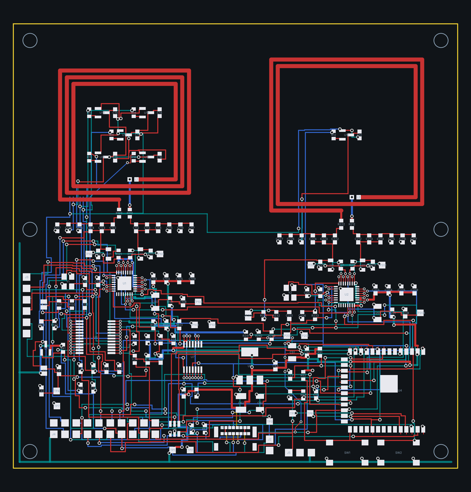

# Démonstrateur Hall + RFID : la carte à deux cases



Carte générée par `tools/boardgen` (module `hallrfid`) depuis
`config/board.yaml` (section `hall_rfid.demo`, qui lit tout ce que
`hall_rfid.mockup` fixe déjà : capteur, boucles, adaptation, étiquettes,
critères) et le modèle `chessboard_calc.hallrfid_demo`. 100 x 100 mm,
4 couches : F.Cu composants et signaux, In1 plan de masse borné à la
bande (aucun cuivre de masse à moins de 4 mm d'une boucle, D12), In2
alimentations et liaisons longues avec la dorsale 3,3 V le long des
bords ouest et sud, B.Cu signaux, le pont de chaque boucle et les
amorces des couloirs de capteurs. Ne pas éditer les fichiers KiCad à la main : modifier le yaml ou
le générateur, puis regénérer. Le rôle de chaque composant, l'assemblage
et les tests sont dans la [note 27](../../docs/notes/27-demonstrateur-hall-rfid.md).

## Blocs

- **Zone de jeu** (y de 0 à 50 mm, au pas de 50) : deux boucles NFC
  dessinées dans le cuivre de la face avant, L60x3 sur A1 (3 spires de
  30 mm) et L70x2 sur B1 (2 spires de 35 mm), chacune refermée par un
  « net tie » et un pont sur la face arrière ; six capteurs Hall
  DRV5055A3 (le centre de chaque case, l'amas de quatre autour du centre
  de A1) avec leur 100 nF et leur filtre RC (1 kΩ près du capteur, 10 nF
  à l'arrivée dans la bande), leurs trios de pistes sortant par le
  couloir réservé au sud-ouest de chaque ouverture. Rien d'autre n'y
  passe : le routeur a la zone fermée hors des boucles.
- **Deux lecteurs MFRC522** (HVQFN-32) dans la bande, chacun sous sa
  boucle : quartz 27,12 MHz, réseau d'adaptation symétrique par côté
  (0 Ω isolateur, L0 560 nH, C0 220 pF, C1 et C2 en valeur principale
  plus complément E12, emplacements de retouche non montés, Rq), points
  de test TX1 et TX2 où un pigtail de NanoVNA se soude, 1 Ω dans TVDD
  avec ses points de test, diviseur de réception à seconde R1 non montée et cavalier à
  souder (D15), points de test TX1, TX2, RX, masse. Valeurs de
  `nfc.matching` : sur A1 Rq 0,68 Ω, C1 56 + 5,6 pF, C2 470 + 33 pF, R1
  3,9 kΩ ; sur B1 Rq 0,47 Ω, C1 82 + 3,3 pF, C2 680 + 56 pF, R1 3,3 kΩ.
- **Chaîne Hall** : CD74HC4067 (capteurs sur les voies 0, 1 et 4 à 7,
  masse en 8, rail divisé par deux en 9, échelon de la LED en 10, les
  voies 11 à 15 sur la barrette J3), rail des capteurs commuté par un
  AO3401A avec cavalier de dérivation, les deux capteurs centraux aussi
  sur une entrée ADC directe.
- **ESP32-S3-WROOM-1-N8** à USB natif (USB-C GCT USB4085, USBLC6-2,
  5,1 kΩ sur CC), antenne sur le bord est sans cuivre dessous, boutons
  EN et BOOT, LED, points de test UART0, barrette d'échappement 2 x 10
  non montée pour une DevKitC ; AMS1117-3.3 avec sa charge tantale ;
  tampon MISO 74LVC125 avec ses 0 Ω de contournement non montés ;
  entrée PICKUP de la vignette de champ.
- Six trous M3 non métallisés (coins de la zone de jeu et de la bande),
  trois mires d'assemblage dans la bande.

## Brochage de l'ESP32-S3

`hall_rfid.demo.esp32.pins` du yaml, repris dans l'en-tête généré du
micrologiciel (`firmware/esp32/hallrfid-demo/main/demo_config.h`) et
vérifié par `tests/test_hallrfid_demo.py` (entrées analogiques sur
l'ADC1, aucune broche de démarrage ni de PSRAM).

## Ouvrir

`hallrfid-demo.kicad_pro` est le fichier à ouvrir dans KiCad 7 : il
associe le schéma généré et la carte, et porte les règles du routeur.
Classe de nets : garde 0,15 mm, piste 0,3 mm (0,5 mm pour VBUS, 3V3 et
le rail des capteurs), vias 0,8/0,4 mm. Les bibliothèques propres au
projet (symbole du MFRC522, net tie des boucles) sont dans
`hardware/lib/`, déclarées dans le projet.

## Générer et vérifier

```bash
PYTHONPATH=tools .venv/bin/python -m boardgen build hallrfid-demo --render docs/images/hallrfid-demo.png
/usr/bin/python3 tools/drc.py hardware/hallrfid-demo/hallrfid-demo.kicad_pcb
/usr/bin/python3 tools/gerbers.py hardware/hallrfid-demo/hallrfid-demo.kicad_pcb
python3 tools/fabcheck.py hardware/hallrfid-demo
cd hardware/hallrfid-demo && sha256sum -c hallrfid-demo-gerbers.sha256
```

Le build dessine d'abord les deux boucles et leurs amenées à la main
(`boardgen.nfcloop`), ferme la zone de jeu au routeur hors des boucles
et des couloirs, route les trios des capteurs en premier, puis le reste
(alimentations en large, signaux en fin), reprend les liaisons murées
par trois tours de dérouté, et finit en géométrie exacte comme les
autres cartes du dépôt (note 04).

## État

Fermée le 18/10/2026, au dix-neuvième build, par `boardgen build
hallrfid-demo` sur le yaml commité :

| Contrôle | Résultat |
|---|---|
| Build | 162 composants, 87 liaisons routées, 0 ouverte, 0 défaut de garde du générateur ; 1624 segments, 413 vias, 14 jonctions de la passe de finition |
| DRC KiCad 7.0.11 | 0 erreur, 0 élément non connecté ; 529 avertissements ignorés : recouvrements de sérigraphie (références sur les pastilles des 0603 serrés), chemins de bibliothèque, et les amorces d'échappement et vias de sortie non prolongés que le routeur laisse derrière lui |
| Archive | `hallrfid-demo-gerbers.zip`, 10 couches, 13 fichiers ; `hallrfid-demo-gerbers.sha256` lie l'archive au `.kicad_pcb` commité |
| `fabcheck` | « bare boards ready » : 99 des 143 composants montés ont un code LCSC ; les 22 lignes sans code sont les condensateurs C0G des réseaux d'adaptation (56, 5,6, 470, 33, 82, 3,3, 680 pF et les emplacements de retouche), le tantale et la puce du net tie, à relever au panier avant un ordre d'assemblage (note 23, paragraphe 5) |

Ce qu'il a fallu pour fermer la carte, et que le générateur garde :
quatre couches ; la zone de jeu fermée au routeur hors des boucles ;
une amorce par liaison dans chaque couloir de capteurs ; les rangées
d'adaptation au pas de 2,5 mm avec leurs nœuds alignés ; un anneau
libre de 5,2 mm autour des puces à pas fin pour leurs vias
d'échappement ; une dorsale 3,3 V large sur la couche interne le long
des bords ouest et sud ; les règles de la capacité quatre couches de
JLCPCB (0,25 mm, garde 0,127 mm, vias 0,6/0,3 mm) ; et une recherche
A* plus gourmande (poids 2,5) pour les liaisons longues.

## Nomenclatures

`bom.csv` liste tout, montés et non montés ; `jlc-bom.csv` et
`jlc-cpl.csv` ne portent que les lignes à code LCSC des composants
montés, pour l'assemblage Standard face avant (le module et le MFRC522
sont des pièces étendues). Les codes des passifs sont des basiques
JLCPCB, à vérifier à l'aperçu de la commande ; les non montés
(emplacements de retouche, seconde R1, 0 Ω de contournement, barrette
d'échappement) sont exclus. La nomenclature chiffrée avec liens et
prix, planche d'étiquettes comprise, est
[`docs/bom-demonstrateur-b.md`](../../docs/bom-demonstrateur-b.md).
